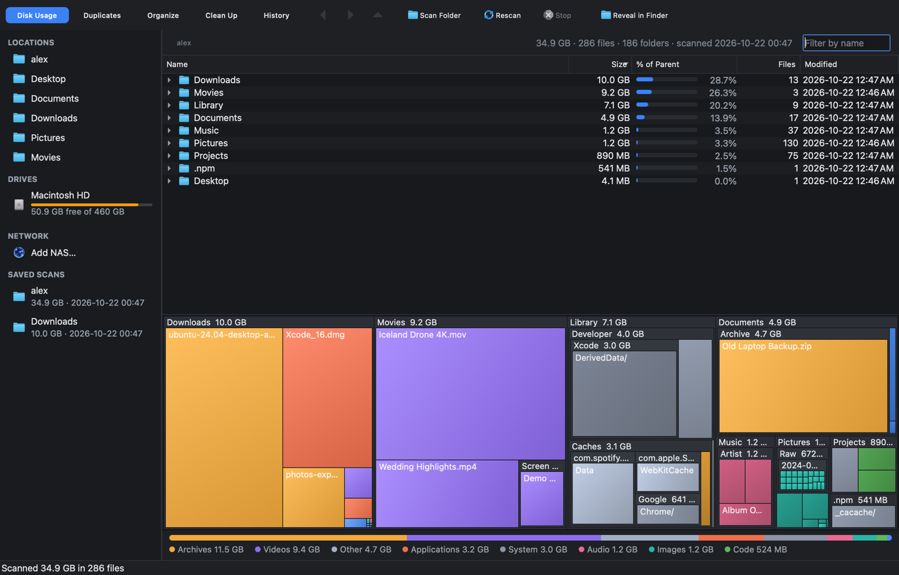
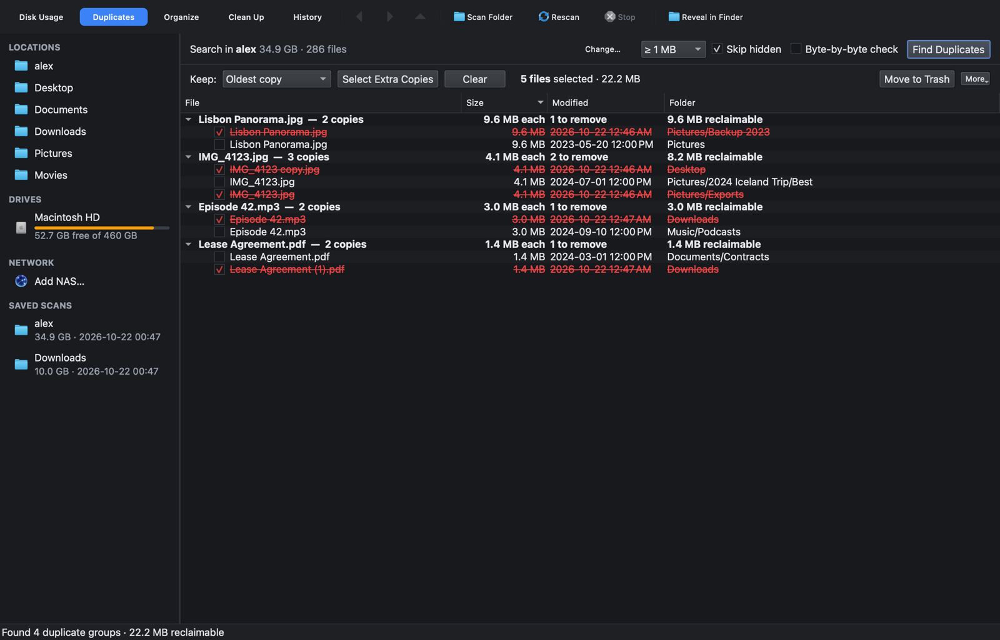
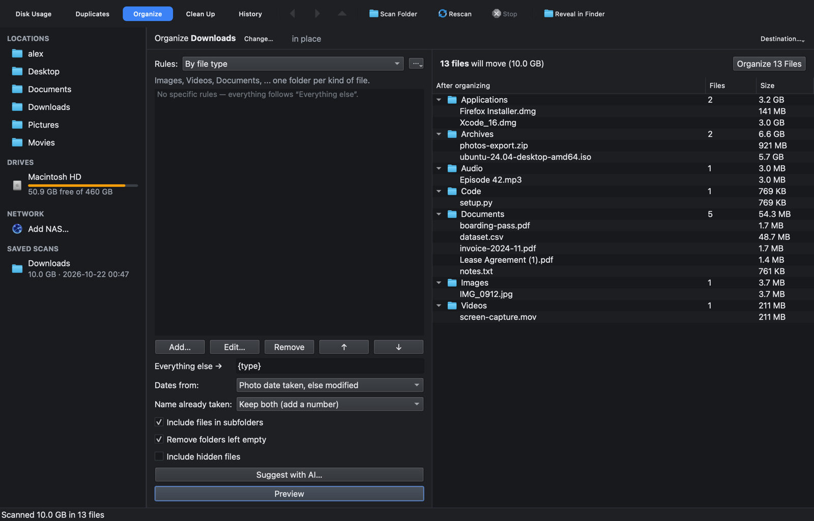
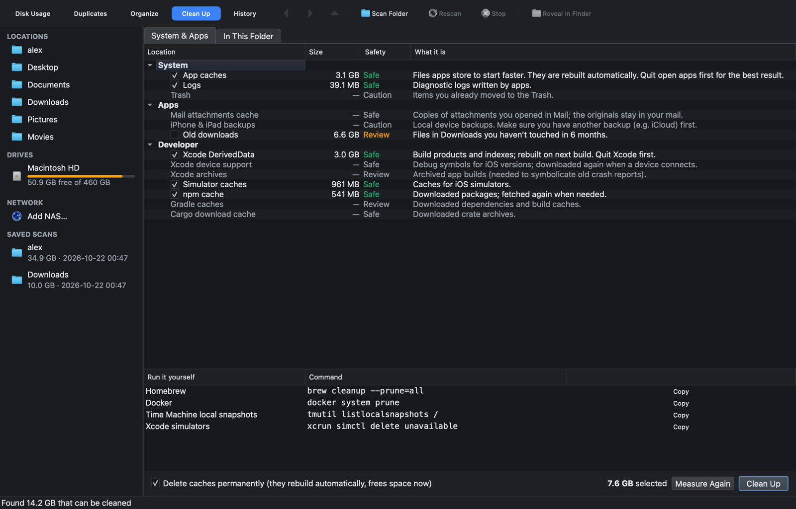

# Storage

A small, fast, cross-platform (macOS · Linux · Windows) app that indexes your drives and NAS,
shows what is using space, finds duplicates, cleans junk and reorganizes folders — **without
ever losing a file**, even if the power goes out halfway through.



> Status: **1.0** — all seven roadmap phases are complete (see [Roadmap](#roadmap)).

## Features

- **See what's using space.** A fast parallel scanner, a sortable size tree with "% of parent"
  bars, a nested treemap coloured by file type, and a type breakdown. Saved scans reopen instantly.
- **Duplicates.** Confirmed by SHA-256 (hardware-accelerated), optionally byte by byte. Keep the
  oldest, newest or shortest-path copy, then trash the rest, replace them with hard links or
  copy-on-write clones, or delete them.
- **Organize.** Rule-based, with templates like `Photos/{year}/{month}` and photo "date taken"
  from EXIF. Six presets, your own saved rule sets, AI-suggested rules (Ollama), and a live
  preview before anything moves.
- **Clean up.** Per-OS caches, logs, Xcode/npm/pip/Gradle/Cargo caches, old downloads, idle
  `node_modules`, large old files and empty folders. Copyable commands for things that need
  admin rights.
- **NAS over SSH.** Every feature works on a NAS, and indexing, hashing and moving run *on* the
  NAS. It uses your own `ssh` and keys.
- **Never loses a file.** Write-ahead journal, re-verification before every change, atomic
  never-overwrite moves, automatic crash recovery, full history and undo.
- **Automation.** `storagectl` with `--json`, an MCP server for Claude, and a localhost REST API,
  all with plan → confirm → apply.
- **Small.** About 1 MB CLI and about 25 MB desktop app. No runtime dependencies.

## Screenshots

**Duplicates.** Confirmed by content. The kept copy is chosen by a rule, and extra copies are
struck through until you act.



**Organize.** Pick or write rules and see exactly where everything will go before anything moves.



**Clean Up.** Caches and junk are measured and marked Safe, Review or Caution. Commands that
need admin rights are listed for you to copy and run.



*Screenshots show a demo home folder.*

| Area | Docs |
|---|---|
| How safety works | [docs/SAFETY.md](docs/SAFETY.md) |
| Organize rules & templates | [docs/RULES.md](docs/RULES.md) |
| Connecting a NAS | [docs/NAS.md](docs/NAS.md) |
| CLI, REST, MCP (Claude) & Ollama | [docs/API.md](docs/API.md) |
| Code structure | [docs/ARCHITECTURE.md](docs/ARCHITECTURE.md) |
| Ideas for the future | [docs/SUGGESTIONS.md](docs/SUGGESTIONS.md) |

## No dependencies

Downloads are self-contained — nothing to install. Building from source needs only a C++20
compiler and CMake (plus Qt 6 for the desktop app). The only third-party code is SQLite,
vendored in [`third_party/`](third_party/README.md); JSON, argument parsing, hashing, HTTP and
the test harness are implemented here.

## Install

Grab the latest build for your OS from [Releases](https://github.com/Gib-git/storage/releases).

- **macOS:** open the `.dmg`, drag *Storage* to Applications. Builds are not notarized yet, so the
  first launch needs right-click → *Open* (or `xattr -dr com.apple.quarantine /Applications/Storage.app`).
- **Linux:** `chmod +x Storage-*.AppImage && ./Storage-*.AppImage`
- **Windows:** unzip and run `Storage.exe`.

## CLI

```sh
storagectl scan ~                 # scan and save to the index
storagectl du ~ -d 2 -n 10        # largest folders, two levels deep
storagectl du -i ~/Projects       # answer from the saved index, no rescan
storagectl scans --json           # machine-readable list of saved scans

storagectl dupes ~/Pictures --min-size 1M              # dry run: what would be removed
storagectl dupes ~/Pictures --keep newest --apply      # move extra copies to Trash
storagectl dupes ~/Pictures --action hardlink --apply  # keep every path, store data once
storagectl presets                                     # built-in organize rules
storagectl organize ~/Downloads --preset tidy          # preview tidying Downloads
storagectl organize ~/Pictures --preset photos --apply # Photos/2024/2024-07/...
storagectl organize ~/Inbox --rules my-rules.json --dest ~/Archive --apply
storagectl clean                                       # what caches & junk would free
storagectl clean --apply                               # clean the recommended (Safe) items
storagectl insights ~/Projects --older 180             # idle node_modules, big old files
storagectl nas add home --host 192.168.1.20 --user admin --root /volume1
storagectl --nas home dupes photos --min-size 1M       # hashing runs on the NAS
storagectl organize ~/Inbox --ai --goal "invoices by year"   # rules suggested by local Ollama
claude mcp add storage -- storagectl mcp               # let Claude use Storage (see docs/API.md)
storagectl history                                     # everything Storage changed
storagectl undo 3                                      # put batch 3 back
```

## How your files are kept safe

Every change goes through a write-ahead journal and is re-verified right before it happens. A
crash at any moment leaves each file in at least one verified location, and the app finishes or
rolls back the interrupted step on next launch. Details: [docs/SAFETY.md](docs/SAFETY.md).

## Build from source

```sh
# CLI only — no Qt needed
cmake --preset cli && cmake --build --preset cli && ctest --preset cli

# Everything (needs Qt 6.5+: brew install qt / apt install qt6-base-dev / Qt online installer)
cmake --preset release && cmake --build --preset release && ctest --preset release
```

## Roadmap

1. ✅ **v0.1 Foundation & Disk Usage**: scanner, index, size browser, treemap, CLI
2. ✅ **v0.2 Duplicates**: confirmed duplicate groups, keep rules, trash / hard link / clone, journal & undo
3. ✅ **v0.3 Organizer**: rules + templates, presets, EXIF dates, live preview, journaled moves
4. ✅ **v0.4 Cleanup**: OS & developer caches, idle project folders, large old files, empty folders
5. ✅ **v0.5 NAS over SSH**: remote scan, hash and organize, run on the NAS itself
6. ✅ **v0.6 Automation & AI**: MCP server for Claude, REST API, Ollama-suggested rules
7. ✅ **v1.0 Polish**: settings, name filter, auto-refresh of stale scans, in-app API, completion alerts

Every phase shipped as a [release](https://github.com/Gib-git/storage/releases). Ideas beyond 1.0 are in
[docs/SUGGESTIONS.md](docs/SUGGESTIONS.md).

## License

[MIT](LICENSE)
